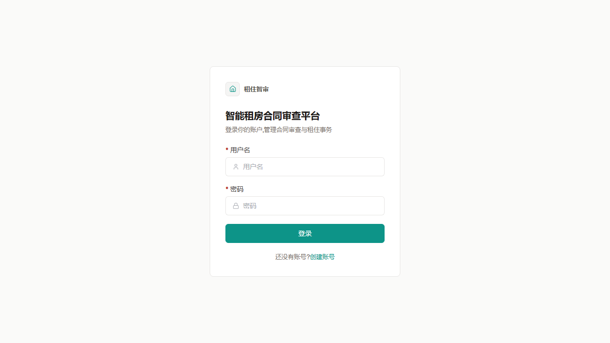
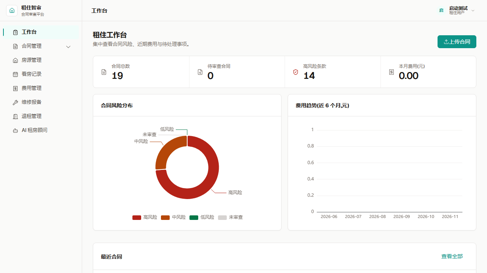
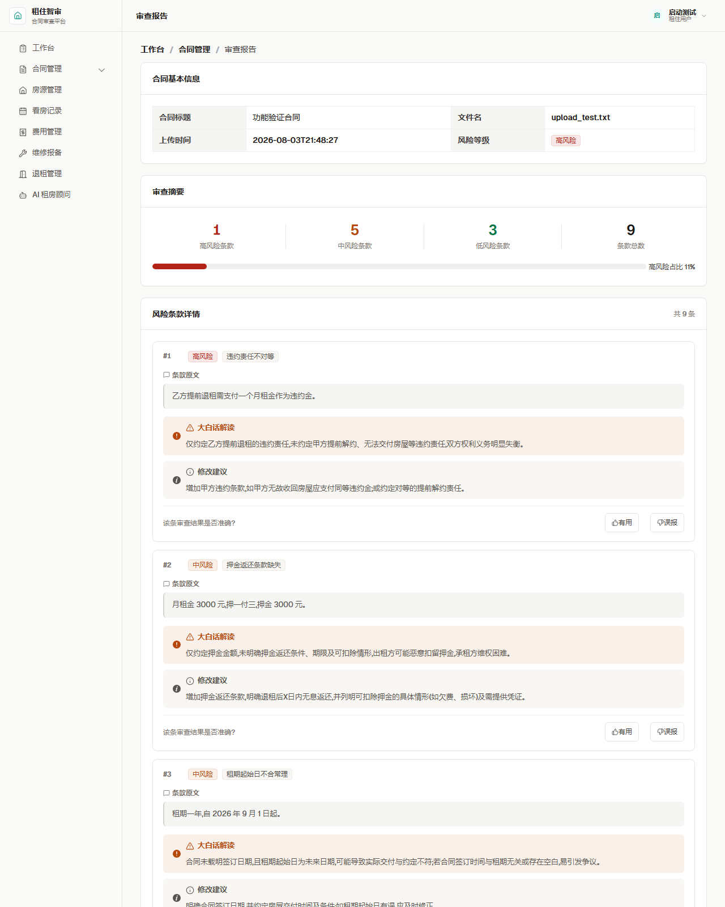
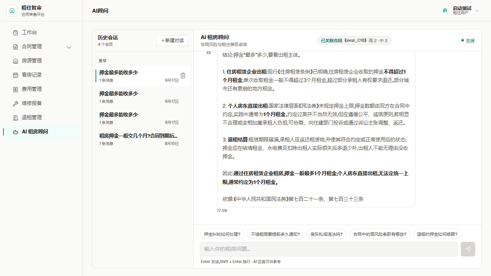
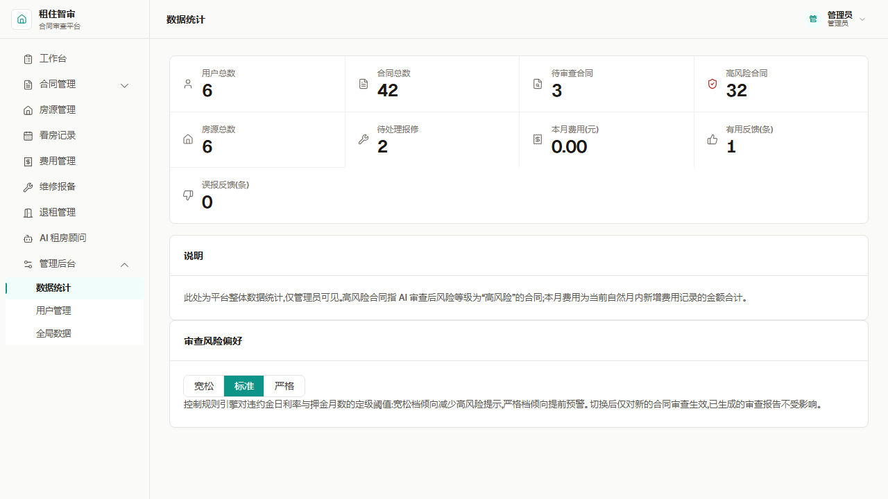

# 智能租房合同审查与租房全流程管理平台

面向租客的租房辅助平台，提供合同上传与 AI 审查、房源管理、费用管理、维修报备、退租管理、AI 法律咨询等功能，并内置管理员后台（用户管理、全局数据查看、平台统计）。

## 界面预览

| 登录页 | 工作台 |
| --- | --- |
|  |  |



| AI 租房顾问 | 后台数据统计 |
| --- | --- |
|  |  |

## 项目结构

```text
rental-platform-backend/    Spring Boot 3 后端（MyBatis-Plus + JWT + MinIO + DeepSeek）
rental-platform-frontend/   Vue 3 前端（Vite + Element Plus + Pinia）
deploy/                     部署示例配置（Nginx、生产配置）
docs/code_review.md         代码审查清单
docs/部署文档.md             局域网/内网穿透/云服务器部署指南
docs/接口测试清单.md         后端接口与自动化测试清单
docs/项目说明.md             项目功能与技术实现说明
```

## 技术栈

- 后端：Java 21、Spring Boot 3.4、MyBatis-Plus、MySQL、MinIO、JWT、Knife4j
- 前端：Vue 3、Vite、Element Plus、Pinia、Axios
- AI：DeepSeek API（模型 `deepseek-flash`）、LangChain4j + bge-small-zh-v1.5 本地向量检索（RAG）
- 文档解析：PDFBox、POI、RapidOCR（扫描版 PDF）
- 可视化与导出：ECharts 图表、PDFBox 审查报告导出 PDF
- 工程化：AOP 接口耗时日志、后端分页、合同文件预览/下载、AI 历史会话管理

## 角色说明

- **普通用户**：使用合同审查、房源、费用、维修、退租、AI 咨询等全部业务功能；
- **管理员**（`admin / admin123456`，角色字段 `role=admin`）：额外拥有管理后台——用户管理（启用/禁用、改角色、重置密码）、全局数据只读查看（合同/房源/费用/报修/退租）、平台数据统计。

## 环境要求

- JDK 21+、Maven 3.8+
- Node.js 20+
- MySQL 8.x、MinIO

## 后端配置

敏感配置通过环境变量注入，不写入代码仓库：

| 环境变量 | 说明 |
| --- | --- |
| `DB_USERNAME` | 数据库用户名（必填） |
| `DB_PASSWORD` | 数据库密码（必填） |
| `DEEPSEEK_API_KEY` | DeepSeek API Key（必填，AI 功能依赖） |
| `MINIO_ACCESS_KEY` | MinIO 访问账号（必填） |
| `MINIO_SECRET_KEY` | MinIO 访问密钥（必填） |
| `JWT_SECRET` | JWT 签名密钥，至少32个随机字符（必填） |

可复制 `rental-platform-backend/.env.example` 查看变量清单；示例文件仅含占位值。

### 启动后端

1. 执行 `rental-platform-backend/sql/schema.sql` 初始化数据库；
2. 启动 MySQL 与 MinIO（`rental-contracts` 桶）；
3. 设置上述环境变量后运行：

```bash
cd rental-platform-backend
mvn spring-boot:run
```

接口文档（Knife4j）：`http://localhost:8088/doc.html`

## 前端

```bash
cd rental-platform-frontend
npm install
npm run dev      # http://localhost:5173
npm run build    # 生产构建
```

Vite 开发服务器已将 `/api` 代理到 `http://localhost:8088`。

## 一键启动

项目根目录提供三个启动脚本，无需手动配置 PATH。脚本用 `$PSScriptRoot` 定位项目目录，
并在环境变量缺失时自动从「用户级 / 系统级」注册表补齐，不依赖当前终端会话。

```powershell
.\start-minio.ps1      # 1. MinIO（合同文件存储，API 9000，控制台 9001）
.\start-backend.ps1    # 2. 后端（http://localhost:8088，接口文档 /doc.html）
.\start-frontend.ps1   # 3. 前端（http://localhost:5173）
```

启动前想确认环境是否齐全，加 `-Check` 只做自检、不启动服务：

```powershell
.\start-backend.ps1 -Check
```

停止全部服务（按端口精确停止 8088 / 5173 / 4173 / 9000 / 9001，不会误杀其他程序）：

```powershell
.\stop-all.ps1          # 加 -Check 只列出谁在占端口，不杀进程
```

> 在 cmd 窗口或资源管理器里双击，请用对应的 `.bat`（`.bat` 会把参数透传给 `.ps1`）：

```cmd
start-minio.bat
start-backend.bat
start-frontend.bat
stop-all.bat -Check
```

### 演示账号

| 角色 | 账号 | 密码 |
|---|---|---|
| 普通用户 | `probe_235205` | `123456` |
| 管理员 | `admin` | `admin123456` |

## 部署到其他环境

见 [docs/部署文档.md](docs/部署文档.md)：支持局域网访问、内网穿透（临时公网）和云服务器部署（Nginx + HTTPS）三种方式，示例配置在 `deploy/` 目录。

## 检查命令

```bash
npm run lint     # 前端代码检查
npm test         # 前端单元测试（Vitest，8 个用例）
npm run build    # 前端构建
mvn test         # 后端测试（45 个用例）
```

> 注：项目已配置 ESLint、Vitest 与 JUnit/Mockito。

## 已知限制

- 合同文本解析支持 TXT/PDF/docx/doc；扫描版 PDF 由 PDFBox 渲染为图像后经 RapidOCR 识别，识别效果受扫描质量影响；
- AI 对话与合同审查依赖 DeepSeek API，需要网络与有效 API Key；
- Redis 缓存属后续规划；JWT 与 MinIO 凭据必须通过环境变量提供。
